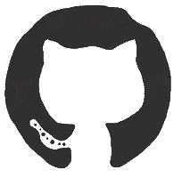

<p align="center">
  
</p>

<div align="center">

;%F0%9F%94%90+Post-Quantum+Cryptography+(CRYSTALS-Kyber);%E2%98%95+Enterprise+Java+%26+FastAPI+Microservices;%F0%9F%9A%80+Turning+Complex+Algorithms+Into+Scalable+Engines)

**`👨‍💻 Software Engineer`** • **`⚙️ Backend Architect`** • **`🌐 Distributed Systems`** • **`🔐 Cryptography Researcher`** • **`📍 Chennai, India`**

<br>

[](https://github.com/Nike-Anand)
[](https://github.com/Nike-Anand)
[](https://github.com/Nike-Anand)
[](https://www.sifytechnologies.com/)
[](https://github.com/Nike-Anand)

</div>

<div align="center">
  
  &nbsp;&nbsp;&nbsp;&nbsp;
  
</div>


##  `> whoami`

```javascript
const nithiyanandam = {
  name: "S. Nithiyanandam",
  role: "Software Engineer & Backend Specialist",
  location: "Chennai, India 🇮🇳",
  currentCompany: "Sify Technologies (Software Development Intern)",
  education: "B.E. Computer Science & Engineering @ SVCE (2023 - 2027) | GPA: 7.9/10",
  coreFocus: [
    "Distributed Backend Architectures",
    "Low-Latency Inference Pipelines",
    "Post-Quantum Cryptography (CRYSTALS-Kyber)",
    "Enterprise Java & Microservices Decomposition",
    "Automated CI/CD Orchestration & Telemetry"
  ],
  leadership: "Team Lead @ Smart India Hackathon (SIH 2024 National Finalist)",
  publishedResearch: "Secure AI Systems (IJCRT / ICICRCET'25)",
  funFact: "I profile microsecond latency bottlenecks while listening to synthwave 🎧",
  motto: "Latency is the enemy, resiliency is the mission. 🚀"
};
```


##  Tech Arsenal

<div align="center">

### 💻 Languages


### ⚙️ Backend, Frameworks & Protocols


### ☁️ Cloud, DevOps & Distributed Infra


### 🗄️ Databases & Caching


### 🔐 Cryptography, Systems & Specialized R&D


</div>


## 🏆 Featured Projects & Architectures

<table>
  <tr>
    <td width="50%" valign="top">
      <h3>🚀 Distributed Backend Serving Stack</h3>
      <p><em>Python • Kubernetes • TorchServe • Docker • gRPC</em></p>
      <ul>
        <li>Architected a fault-tolerant, horizontally scalable backend inference engine.</li>
        <li>Implemented dynamic request batching & model quantization, slashing p99 latency by <strong>35% under peak stress</strong>.</li>
        <li>Built automated Prometheus metric scrapers and Grafana dashboards for cluster observability.</li>
      </ul>
      <p>
        <a href="https://github.com/Nike-Anand"></a>
        
      </p>
    </td>
    <td width="50%" valign="top">
      <h3>🔐 Post-Quantum Secure IoT Framework</h3>
      <p><em>Python • CRYSTALS-Kyber • Microcontrollers • SIH 2024</em></p>
      <ul>
        <li>Engineered quantum-resistant Key Encapsulation Mechanism (KEM) for resource-constrained IoT edge devices.</li>
        <li>Achieved <strong>3x faster secure key exchange</strong> compared to traditional RSA/ECC protocols on embedded hardware.</li>
        <li>Led team of 6 engineers to the national finals of <strong>Smart India Hackathon 2024</strong>.</li>
      </ul>
      <p>
        <a href="https://github.com/Nike-Anand"></a>
        
      </p>
    </td>
  </tr>
  <tr>
    <td width="50%" valign="top">
      <h3>⚡ Real-Time Verification Microservice</h3>
      <p><em>FastAPI • Docker • Redis • Celery • Asynchronous Workflows</em></p>
      <ul>
        <li>Engineered sub-second verification microservice handling concurrent asynchronous validation requests.</li>
        <li>Reduced API response latency from 1.2s to under <strong>180ms</strong> with connection pooling and Redis in-memory caching.</li>
        <li>Configured multi-stage containerized CI/CD workflow with automated health checks.</li>
      </ul>
      <p>
        <a href="https://github.com/Nike-Anand"></a>
        
      </p>
    </td>
    <td width="50%" valign="top">
      <h3>🤖 Agentic Pipeline Automation Framework</h3>
      <p><em>Python • GitHub Actions • Synthetic Evaluation • Telemetry</em></p>
      <ul>
        <li>Designed a multi-stage automated routing pipeline integrated into CI/CD workflows.</li>
        <li>Implemented automated semantic validation, regressions sweeps, and diagnostic feedback loops.</li>
        <li>Integrated webhook alerting triggers for continuous deployment verification.</li>
      </ul>
      <p>
        <a href="https://github.com/Nike-Anand"></a>
        
      </p>
    </td>
  </tr>
</table>


## 📊 Live GitHub Telemetry

<div align="center">


<br><br>


<br><br>

<h3>📈 Contribution Heatmap</h3>


</div>


## 🎮 Dino Run

<div align="center">
  
</div>


## 📜 Quest Log (Developer Progression)

<details>
<summary>🗺️ <b>Main Quest: Backend & Distributed Systems Architecture</b></summary>
<br>

| Status | Quest Milestone | Experience Points |
| :----: | :-------------- | :---------------: |
|   ✅   | Master Core Data Structures & Algorithmic Complexity | +500 XP |
|   ✅   | Architect Scalable FastAPI & Enterprise Java Microservices | +750 XP |
|   ✅   | Implement Dynamic Inference Batching & Quantization (-35% Latency) | +1000 XP |
|   ✅   | Deploy Fault-Tolerant Microservices with Docker & Kubernetes | +1000 XP |
|   🔄   | Build High-Throughput Distributed Raft Consensus Service | +1500 XP |
|   🔄   | Deep Dive into Kernel-Level eBPF Networking & Tracing | +2000 XP |

</details>

<details>
<summary>🔐 <b>Side Quest: Post-Quantum Cryptography & Hardware Security Arc</b></summary>
<br>

| Status | Quest Milestone | Experience Points |
| :----: | :-------------- | :---------------: |
|   ✅   | Implement CRYSTALS-Kyber KEM Lattice-Based Cryptography | +1000 XP |
|   ✅   | Optimize Key Encapsulation for Resource-Constrained IoT Hardware | +1200 XP |
|   🏆   | Lead 6-Member Engineering Team as **SIH 2024 National Finalist** | +2500 XP |
|   🏆   | Qualify as **Smart India Hackathon (SIH) 2025 National Finalist** | +2500 XP |
|   📜   | Publish Research Paper *"Secure AI Systems"* (IJCRT / ICICRCET'25) | +1500 XP |

</details>

<details>
<summary>💼 <b>Side Quest: Enterprise Engineering & Industry Internships</b></summary>
<br>

| Status | Milestone | Experience Points |
| :----: | :-------- | :---------------: |
|   ✅   | **Sify Technologies** (Software Development Intern): Enterprise Java, Factory & Strategy Patterns | +1500 XP |
|   ✅   | **Altruisty** (Backend & Systems Research Intern): Inference Optimization across 12+ projects | +1200 XP |
|   ✅   | **Vodafone Idea (Vi)** (Data Analyst Intern): SQL Optimization across 10M+ rows (-40% runtime) | +1000 XP |

</details>

<details>
<summary>🎁 <b>Secret Loot Chest — Click to Open!</b></summary>
<br>

<div align="center">
  
  <br>
  <b>🎉 You unlocked the High-Concurrency Secret Chest!</b><br>
  <em>Awarded for inspecting distributed system internals and staying curious.</em><br><br>
  
</div>

</details>


## 💬 Developer Wisdom

<div align="center">
  
</div>


## 📬 Let's Connect & Collaborate

<div align="center">

<a href="https://linkedin.com/in/nithiyanandam-s"></a>
&nbsp;&nbsp;&nbsp;&nbsp;
<a href="https://github.com/Nike-Anand"></a>
&nbsp;&nbsp;&nbsp;&nbsp;
<a href="https://instagram.com"></a>

<br><br>

[](mailto:nithiyanandam4826@gmail.com)
[](https://github.com/Nike-Anand)

<br>

```
⚡ Available for Full-Time Backend Software Engineering, Systems Engineering & Distributed Architecture roles.
```


<br><br>


&nbsp;&nbsp;


<br><br>


</div>
